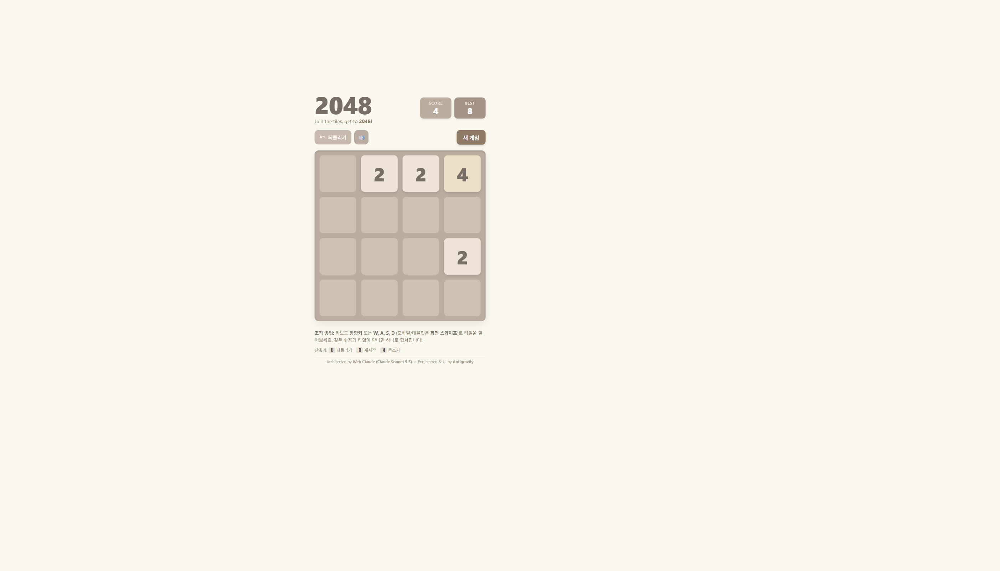

# 2048 Game (Web Claude & Antigravity Edition)

> 🎮 A modern, high-performance web implementation of the classic **2048** puzzle game, co-created through human-AI pair programming with **Claude Sonnet 5.5** (Web Claude via Ego Lite) and **Antigravity**.



## ✨ Features

- **Decoupled Architecture**: Pure ES6+ Game Engine (`engine.js`) designed independently from DOM / UI for 100% deterministic logic and easy testability.
- **Smooth Sliding & Merging**: Coordinated CSS transitions using stable tile IDs to ensure tiles glide smoothly across cells without layout jumping.
- **Web Audio API Sound Effects**: Zero external audio assets! Built-in procedural audio synthesizers for tile sliding, harmonic chime merging (higher pitches for higher tile values), tile spawning, win fanfare, and game-over sound.
- **Unlimited Undo (`U`)**: Revert previous moves via immutable snapshot state history.
- **Responsive & Mobile Ready**: Full keyboard navigation (Arrow keys / WASD) and touch swipe gesture detection for smartphones and tablets.
- **Persistent High Scores**: Automatically saves your `Best Score` and sound preference in `localStorage`.

---

## 🕹️ Controls

| Action | PC Keyboard | Mobile / Tablet |
| :--- | :--- | :--- |
| **Move Tiles** | `Arrow Keys` or `W, A, S, D` | Swipe (Up, Down, Left, Right) |
| **Undo Move** | `U` or click **되돌리기** | Tap **되돌리기** |
| **New Game** | `R` or click **새 게임** | Tap **새 게임** |
| **Toggle Mute** | `M` or click 🔊 / 🔇 | Tap 🔊 / 🔇 icon |

---

## 🛠️ Tech Stack & Structure

- **HTML5**: Semantic layout and responsive modals.
- **Modern CSS3**: Dynamic CSS custom properties (variables), Glassmorphism backdrop filters, CSS Grid, and GPU-accelerated transforms.
- **Vanilla JavaScript (ES2022)**:
  - [`engine.js`](./engine.js): Pure `Game2048Engine` with immutable board operations, traversal math, and event emitters.
  - [`app.js`](./app.js): DOM manipulation, Web Audio synthesis, keyboard & touch listeners.
- **Node.js**: [`test.js`](./test.js) for CLI verification of engine logic.

---

## 🚀 How to Run Locally

You can serve the game using any static HTTP server.

Using Python:
```bash
python -m http.server 8080
```

Using Node (npx):
```bash
npx serve .
```

Then navigate to `http://localhost:8080` in your web browser.

---

## 🤝 Authors & Credits

- **Core Engine Architecture & Data Model**: Designed by **Claude Sonnet 5.5** (Web Claude)
- **Frontend Implementation, Sound FX & Ego Lite Testing**: Engineered by **Antigravity**
- **Original 2048 Concept**: Inspired by Gabriele Cirulli
